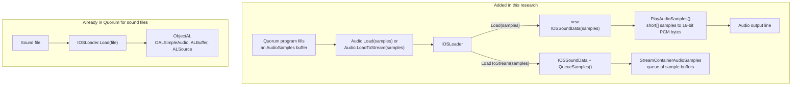

<div align="center">

# iOS Audio for the Quorum Programming Language

**Undergraduate research · University of Nevada, Las Vegas · Spring 2021**

[](#how-the-ios-audio-path-works)
[](Plugins/SoundPlugin/SoundPlugin/src/plugins/quorum/Libraries/Sound)
[](https://quorumlanguage.com)
[](#credits)
[](LICENSE)

**An Vo (James Emerson)** · [@jamesEmerson112](https://github.com/jamesEmerson112) · with **Tony Amin**

</div>

---

This repository holds my Spring 2021 undergraduate research at UNLV on [Quorum](https://quorumlanguage.com), the evidence-based programming language created by Andreas Stefik and the Quorum team. Quorum's Sound library could already play sound files on iOS. It could not play `AudioSamples`, the class a Quorum program uses to build audio one sample at a time, for example to generate white noise. The iOS loader in upstream Quorum 8 rejected sample buffers outright:

```java
// IOSLoader.java, upstream Quorum 8 (July 2020)
@Override
public Data Load(quorum.Libraries.Sound.AudioSamples_ buffer)
{
    throw new UnsupportedOperationException("Direct AudioBuffer manipulation is not currently supported on this platform.");
}
```

With Tony Amin, I replaced that refusal with a path through `IOSSoundData`, which is written to convert an `AudioSamples` buffer into 16-bit PCM and send it to an audio output line. We also added a queue for streaming one buffer after another. This work was not merged into upstream Quorum, whose [iOS loader](https://github.com/qorf/quorum-language/blob/main/Plugins/QuorumPlugins/src/main/java/plugins/quorum/Libraries/Sound/IOS/IOSLoader.java) still throws this exception today.

## At a glance

| | |
| --- | --- |
| **Researcher** | An Vo (James Emerson) |
| **Collaborator** | Tony Amin |
| **Institution** | University of Nevada, Las Vegas |
| **Dates** | February 14 to April 18, 2021 |
| **Starting point** | Upstream Quorum 8 as of July 12, 2020, imported as one snapshot commit, [`afe28a2`](https://github.com/jamesEmerson112/iOS-audio-demo-for-Quorum-language/commit/afe28a2da42ec9cac2665f3261475b4cf83e83be) |
| **Code** | Quorum's Sound plugin: `AudioSamples`, `IOSLoader`, `IOSSoundData` |
| **Status** | Research prototype. See [where it stood in April 2021](#where-it-stood-in-april-2021). |
| **Commits** | 15 by An Vo (James Emerson) and 6 by Tony Amin, all [listed below](#commit-history) |

## What I built

**`AudioSamples` loads on iOS.** `IOSLoader.Load(AudioSamples)` used to throw. It now returns a new `IOSSoundData` built from the samples. See [`IOSLoader.java`](Plugins/SoundPlugin/SoundPlugin/src/plugins/quorum/Libraries/Sound/IOS/IOSLoader.java).

**From samples to an output line.** A new `IOSSoundData(AudioSamples)` constructor hands the buffer to `PlayAudioSamples`. That method is written to read the 16-bit `short[]` sample buffer, pack it into bytes, and write the bytes to an audio output line. The first version used `sun.audio` for output. The final commit switched to a `javax.sound.sampled` `SourceDataLine` at 44.1 kHz, 16-bit mono. See [`IOSSoundData.java`](Plugins/SoundPlugin/SoundPlugin/src/plugins/quorum/Libraries/Sound/IOS/IOSSoundData.java).

**A queue for streaming.** I added `StreamContainerAudioSamples` to `IOSSoundData`. It is a growable array of `AudioSamples` buffers, modeled on the libGDX-derived `StreamContainer` that the class already used for sound IDs. Tony routed `LoadToStream(AudioSamples)` through it with `QueueSamples` and re-implemented its `insert` and `resize`.

**`AudioSamples` opened up to platform code.** I documented the members of the Java side of `AudioSamples`, exposed the raw buffer through `GetBufferShort()`, and added `Set(index, value)`. I also commented out the dummy `Load` call in its static initializer, which upstream used to force OpenAL to initialize. See [`AudioSamples.java`](Plugins/SoundPlugin/SoundPlugin/src/plugins/quorum/Libraries/Sound/AudioSamples.java).

**Smaller changes along the way.**

- `AVAudioPlayerDelegateAdapter.didFinishPlaying` used to throw `UnsupportedOperationException`. It now prints whether playback finished successfully.
- `Audio.Load(AudioSamples)` and the data it holds became static.
- On Android, `EnableListenerDoppler` and `DisableListenerDoppler` now log that they are unsupported instead of silently doing nothing.
- In `ClientSpeak`, Quorum's text-to-speech client, I added `ConsoleHandler` logging to the error paths while debugging on an iPhone.
- I removed merge-conflict markers left over from merging our two lines of work, and fixed compile errors in `AudioSamples.Copy()`, `IOSSoundData` and `Microphone`.

## How the iOS audio path works



The diagram shows the path as it was designed. The next section covers where the code actually stood.

## Where it stood in April 2021

I remember recording audio and playing it back. I also remember a sound file playing correctly from Quorum code on both a Mac and an iPhone. On iOS, file playback goes through the ObjectAL path that Quorum already had.

The committed `AudioSamples` path had not yet reached working audio on iOS when the semester ended:

- `PlayAudioSamples` sends its output through `javax.sound.sampled`, and earlier through `sun.audio`. Neither package is part of the RoboVM runtime that compiles Java for iOS. I checked this against its open-source fork, MobiVM.
- `PlayAudioSamples` calls `byte_buffer.clear()` before each `putShort`, so it writes only the last sample, two bytes, to the output line.
- The `AudioSamples` constructor leaves `soundBuffer` and `sourcePool` as `null`, so `SetVolume`, `IsPlaying` and `Dispose` would throw a `NullPointerException` on that object.
- `QueueSamples` counts each queued buffer, but the line that stores it in `StreamContainerAudioSamples` is commented out, and `UnqueueSamples` still throws.
- `AudioSamples.GetQuorumFile()` is a stub that returns `null`. It was meant for the save-to-a-file option in the research log below.

The code is kept exactly as it was committed in 2021, so these issues are left in place as part of the record.

## Research log

These are my working notes from the semester, kept exactly as I wrote them in the fork's README.

```text
This is the **Forked** version for **An Vo** and **Tony** attempting to enhance Sound Plugin

###Log
03/05/2021
there are 2 options:
    1. make AudioSamples save an audio file and have it return a string so that
IOSSoundData can read
   2. Implement IOSSsoundData so that it can handle the short array of file
    3. convert audiosamples to File_
    4. ask where to locate the master project for netBeans
      5. ask to speak to alleew (from audiosamples) and Jeff Willson from FilePlugin
    

02/24/2021
What's "AudioSamples_"? And why are not using "AudioSamples" instead?

02/21/2021
AudioSamples class is at Plugin/SoundPlugin/SoundPlugin/src/plugins/quorum/Libraries/Sound
there are 17 related problems needed to be sorted out
```

## Commit history

Every commit below links to its page on GitHub. This repository starts from one snapshot commit of Quorum's July 2020 source instead of Quorum's full history, so most SHAs differ from Bitbucket. Authors, dates, messages and file changes are unchanged. My two commits from a separate line of work, `e6dacf8` and `9b00c3e`, keep their Bitbucket SHAs, because they never sat on the 2020 base.

My commits appear under three names: James Emerson, James Emerson (An Vo), and An Vo. The two commits marked "as An Vo" were made on a UNLV library iMac, so GitHub can't link them to my account, but they are mine.

### An Vo (James Emerson)

| Date | Commit | What changed |
| --- | --- | --- |
| Feb 14, 2021 | [`44926e6`](https://github.com/jamesEmerson112/iOS-audio-demo-for-Quorum-language/commit/44926e64eafe970d88602ae657ebf2a763e9366c) | Added `ConsoleHandler` logging to the error paths in `ClientSpeak` for debugging on an iPhone. |
| Feb 21, 2021 | [`5917526`](https://github.com/jamesEmerson112/iOS-audio-demo-for-Quorum-language/commit/5917526e9a7a26271626008624ec364865a68dc0) | Studied and annotated `AudioSamples.java`, and started the research log. |
| Feb 25, 2021 | [`8170a63`](https://github.com/jamesEmerson112/iOS-audio-demo-for-Quorum-language/commit/8170a6344f91bba72b642d22689bf6931af204df) | Documented the copy methods in `AudioSamples` and logged open questions. |
| Feb 27, 2021 | [`6ea1580`](https://github.com/jamesEmerson112/iOS-audio-demo-for-Quorum-language/commit/6ea158032b61e8fc6e6a4011bfda49e104a2df60) | Fixed errors in `AudioSamples` and `Microphone`. |
| Mar 6, 2021 | [`39670a8`](https://github.com/jamesEmerson112/iOS-audio-demo-for-Quorum-language/commit/39670a8e53aeff5da6515440dda07be868167924) | Implemented `AVAudioPlayerDelegateAdapter.didFinishPlaying` and added notes to the research log. |
| Mar 6, 2021 | [`67c9381`](https://github.com/jamesEmerson112/iOS-audio-demo-for-Quorum-language/commit/67c9381bb8d986d1e681beea716424e056ad2c54) | Made a first pass at `IOSLoader.Load(AudioSamples)` through a static `Audio.Load`. |
| Mar 6, 2021 | [`ab5621f`](https://github.com/jamesEmerson112/iOS-audio-demo-for-Quorum-language/commit/ab5621f0abc91a4a3225b3b2d7eff985c9d03655) | Pointed `Load(AudioSamples)` at a new `IOSSoundData(AudioSamples)` constructor, and stubbed `GetQuorumFile()` for a save-to-file approach. |
| Mar 13, 2021 | [`b052740`](https://github.com/jamesEmerson112/iOS-audio-demo-for-Quorum-language/commit/b0527400f3a7c14bd1fc8d19a025bd58798f8d31) | Wrote a first version that converts the `short[]` sample buffer to bytes for `sun.audio` playback. Added `GetBufferShort()` and committed Quorum build outputs. |
| Mar 24, 2021 | [`f8b1f74`](https://github.com/jamesEmerson112/iOS-audio-demo-for-Quorum-language/commit/f8b1f74b05de41f62f65df70cee1cb808f552ac0) | Moved the playback code from `IOSLoader` into `IOSSoundData.PlayAudioSamples`. *(as An Vo)* |
| Mar 24, 2021 | [`3751a0f`](https://github.com/jamesEmerson112/iOS-audio-demo-for-Quorum-language/commit/3751a0f0e8ffaff8cb2ac6193f776d6f89629b80) | Set up the fields of `IOSSoundData` for sample-based audio, which has no file path or `ALBuffer`. *(as An Vo)* |
| Mar 28, 2021 | [`e6dacf8`](https://github.com/jamesEmerson112/iOS-audio-demo-for-Quorum-language/commit/e6dacf8b2d2eea7e6c58ce6db26675becd44532e) | Made the two unsupported Android Doppler listener calls log a message. |
| Mar 31, 2021 | [`9b00c3e`](https://github.com/jamesEmerson112/iOS-audio-demo-for-Quorum-language/commit/9b00c3e9c0fd53e62ae433f234c784bcf3f564fb) | Added `StreamContainerAudioSamples`, a queue of sample buffers, to `IOSSoundData`. |
| Apr 1, 2021 | [`3570102`](https://github.com/jamesEmerson112/iOS-audio-demo-for-Quorum-language/commit/3570102d16fa5d4aa7f5d25c2aeeb9daa673d065) | Removed merge-conflict markers left in `IOSSoundData` and `AndroidAudioManager`. |
| Apr 6, 2021 | [`974de51`](https://github.com/jamesEmerson112/iOS-audio-demo-for-Quorum-language/commit/974de51037028e487554687f67619a7ce16a42fa) | Fixed compile errors in `AudioSamples.Copy()`, `IOSSoundData` and `Microphone`, and added a hello-world Quorum program. |
| Apr 18, 2021 | [`2314916`](https://github.com/jamesEmerson112/iOS-audio-demo-for-Quorum-language/commit/23149165c4bf645542779fcb00d8f065eba29f04) | Switched the output to `javax.sound.sampled`, added `AudioSamples.Set`, and commented out the dummy `Load` in the static initializer of `AudioSamples`. |

### Tony Amin

| Date | Commit | What changed |
| --- | --- | --- |
| Mar 31, 2021 | [`4dd2d05`](https://github.com/jamesEmerson112/iOS-audio-demo-for-Quorum-language/commit/4dd2d055bbc415fa01cd1938888a6144131d1ea0) | Rewrote `.gitignore`. |
| Mar 31, 2021 | [`cfd5922`](https://github.com/jamesEmerson112/iOS-audio-demo-for-Quorum-language/commit/cfd59220a4b7cddf9dd7aa3daae5ec5b8ee9b2ce) | Routed `LoadToStream(AudioSamples)` through `QueueSamples` and the sample-buffer queue. |
| Mar 31, 2021 | [`1f764ce`](https://github.com/jamesEmerson112/iOS-audio-demo-for-Quorum-language/commit/1f764ce3af13403e334dc8f6284e3bc96ea8a102) | Merged my separate line of work (`e6dacf8` and `9b00c3e`) into the main line. |
| Mar 31, 2021 | [`3ec6295`](https://github.com/jamesEmerson112/iOS-audio-demo-for-Quorum-language/commit/3ec629515e28be294cf630762ec8c623b676294a) | Removed the immediate playback call from `LoadToStream`. |
| Apr 8, 2021 | [`9214581`](https://github.com/jamesEmerson112/iOS-audio-demo-for-Quorum-language/commit/92145812a69b32121f07a83569b6d86fb339b3ef) | Re-implemented `insert` and `resize` for `StreamContainerAudioSamples`. |
| Apr 11, 2021 | [`3003e58`](https://github.com/jamesEmerson112/iOS-audio-demo-for-Quorum-language/commit/3003e5861d670fca90cb0fce11f27cf8eb75c40b) | Made `LoadToStream` return the stream instead of `null`. |

## Repository layout

| Path | What it holds |
| --- | --- |
| [`Plugins/SoundPlugin/SoundPlugin/src/plugins/quorum/Libraries/Sound/`](Plugins/SoundPlugin/SoundPlugin/src/plugins/quorum/Libraries/Sound) | Quorum's Sound plugin in Java. `AudioSamples.java`, `Audio.java` and `Microphone.java` changed here. |
| [`…/Sound/IOS/`](Plugins/SoundPlugin/SoundPlugin/src/plugins/quorum/Libraries/Sound/IOS) | The iOS backend: `IOSLoader`, `IOSSoundData`, `AVAudioPlayerDelegateAdapter`, and the ObjectAL bindings such as `OALSimpleAudio`, `ALBuffer` and `ALSource`. |
| [`…/Sound/Android/AndroidAudioManager.java`](Plugins/SoundPlugin/SoundPlugin/src/plugins/quorum/Libraries/Sound/Android/AndroidAudioManager.java) | The Android backend, where the two Doppler calls now log. |
| [`…/tts/impl/ClientSpeak.java`](Quorum/Library/Standard/Plugins/org/sodbeans/phonemic/tts/impl/ClientSpeak.java) | The text-to-speech client that gained console logging. |
| `Hello.quorum`, `QuorumTomcat/dependencies/Hello.quorum` | A hello-world Quorum program added during the research. |
| `QuorumStandardLibrary.jar`, `QuorumStandardLibrary.js`, `QuorumStandardPlugins.jar`, `jar_files/`, `Quorum/Quorum.jar` | Quorum build outputs committed during the research. |
| `.gitignore`, `.idea/` | Git and IDE settings updated during the research. |
| Everything else | Upstream Quorum 8 as of July 2020. |

## About Quorum

Quorum is a general-purpose programming language shaped by evidence. Its team runs studies with people of many ages and levels of experience, and feeds the results back into the language's design. Its libraries are designed to work for a broad population, including people with disabilities. Learn more at [quorumlanguage.com](https://quorumlanguage.com). Current development happens at [qorf/quorum-language](https://github.com/qorf/quorum-language).

### Building (2021 instructions)

These are the upstream instructions from the time of this snapshot. Open Quorum Studio, open the Quorum project in the `Quorum/` folder, and build it normally. For the command line, [`Quorum/ReadMe.txt`](Quorum/ReadMe.txt) documents the compiler. For example, `java -jar Quorum.jar Hello.quorum` compiles `Hello.quorum`.

## Related work

The Fall 2020 UNLV senior project [Quorum_iOS_Transpiliation](https://github.com/thenick775/Quorum_iOS_Transpiliation) re-integrated the open-source RoboVM compiler into Quorum's toolchain, using the MobiVM fork, so that Quorum applications could be compiled to iOS binaries.

## Credits

- **An Vo (James Emerson)**, researcher: the `AudioSamples` path through `IOSLoader` and `IOSSoundData`, the sample-buffer queue, and the other changes listed above.
- **Tony Amin**, collaborator: the streaming path through `LoadToStream` and `QueueSamples`, the queue's `insert` and `resize`, and the merge of our two lines of work.
- **Andreas Stefik and the Quorum team** created Quorum and the Sound plugin this work builds on. Bill Allee (`alleew`) wrote the original versions of the Sound plugin classes changed here, except `AVAudioPlayerDelegateAdapter`.
- The iOS audio bindings are adapted from libGDX (Niklas Therning), and the native audio layer is Karl Stenerud's ObjectAL.

## License

This is a fork of Quorum, so it keeps Quorum's license. [`LICENSE`](LICENSE) is a copy of the BSD-style license that shipped with the 2021 source tree in [`Quorum/Installer/License.txt`](Quorum/Installer/License.txt), © 2011–2019 Andreas Stefik. Upstream Quorum has since moved to the [BSD-3-Clause license](https://github.com/qorf/quorum-language/blob/main/License.txt).

Some files keep their own terms. The libGDX-derived iOS bindings carry Apache 2.0 headers, and ObjectAL's license is in [`Plugins/SoundPlugin/iOS/ObjectAL/`](Plugins/SoundPlugin/iOS/ObjectAL). My changes are released under the same terms as the Quorum code around them.

## Source

This repository was imported from [bitbucket.org/jamesEmerson/quorum-language](https://bitbucket.org/jamesEmerson/quorum-language), branch `master` at `4535be5`, which is [`2314916`](https://github.com/jamesEmerson112/iOS-audio-demo-for-Quorum-language/commit/23149165c4bf645542779fcb00d8f065eba29f04) here. Instead of Quorum's full history, it starts from one snapshot commit of upstream Quorum 8 as of July 12, 2020, followed by the 21 commits from 2021 with their original authors, dates and messages. Quorum's full history is public at [qorf/quorum-language](https://github.com/qorf/quorum-language).
